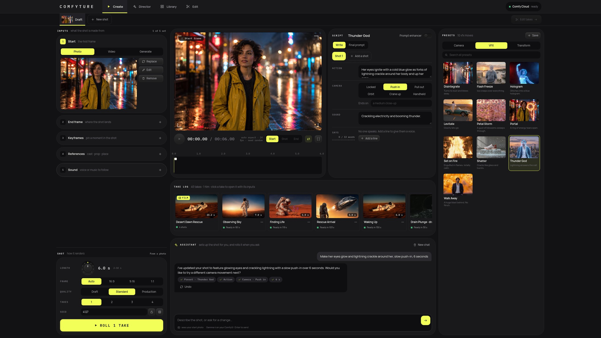
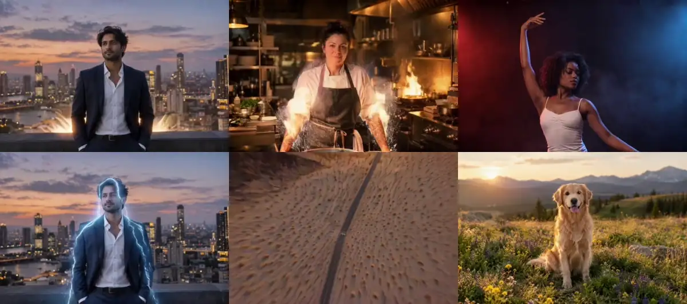
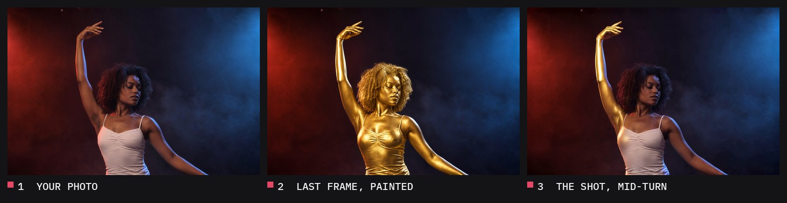
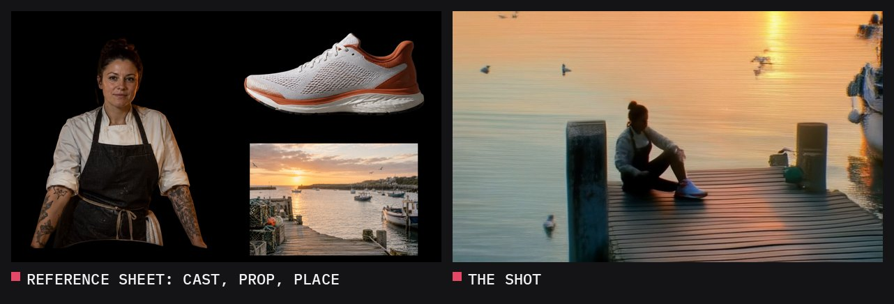

# Comfyture

**One photo in, a cinematic shot with sound out. One sentence in, a short film out.**

Comfyture is an open-source preset studio. Pick a photo, pick a preset (a crash zoom, setting yourself on fire, turning into a gold statue) and get a short video with synchronized sound. Every preset is a readable file. The video and sound models are open weights, and so are the pictures by default (Qwen Image 2.1); the artist picker adds the partners' image models on Comfy Router (GPT Image 2.5, Nano Banana, FLUX.2 and FLUX 3, Seedream 5, Qwen Image 3.0, Kling, Luma, Runway), billed in Comfy credits with the same key. The writers and assistants run on Claude Sonnet 5.5 through Comfy Router by default, or on open-weights Gemma 4 if you pick it. `COMFYTURE_OPEN_WEIGHTS=1` keeps every partner model out. It's built on the [Comfy Developer Platform](https://docs.comfy.org/development/overview), and the same code runs on your own GPU or on Comfy Cloud.

> Built for Comfy's #OpenSourceHiggsfield challenge: a preset video studio that is open source, open weights by default for every picture, video and sound, with the partners' models on Comfy Router one pick away.





## What it does

Comfyture is a desk for directing a shot: give it the frames, write the script, set the camera, roll takes and keep the good one. Then chain shots into a film, or let Story plan and make the whole film from one sentence.

- **Home.** Comfyture opens on your projects: every story, stage and edit in one grid, newest first, the newest ones big with a story's storyboard under its frame. Write one sentence in its prompt and Write the story makes a whole new story from it; or start an empty story, stage, shot or edit. The logo leads back to it.
- **Five sections, in the order a film is made.** **Story** writes and prepares the film on one screen: its bible, its script with the storyboard, and its shots. **Stage** blocks a scene with mannequins and set pieces and renders it as control references and control videos. **Shot** is the desk. **Cut** is the editing room: a timeline of clips, titles, voices, music and sound, with AI to make what's missing. **Library** holds every take, film and image.
- **Assistant.** A floating chat over the desk, like Higgsfield's: a bar at the bottom, the conversation above it when you want it. It knows how the app works: a manual written from the app's own code (which workflow runs for which inputs, every input and its limits, how the script becomes the exact prompt, the presets) goes with every message, together with the open tab's whole state and the latest takes. Say what you want and the model picked on the bar (Claude Haiku 4.5 through Comfy Router by default, any other on the picker, or Gemma 4 inside ComfyUI), with your start photo in view, picks a preset, writes one to four shots with their cuts, sets length, frame, quality and takes, draws or edits the start photo, draws references, sets a paint, switches a video between extend and copy motion, opens the next shot from a take's last frame, and rolls when you ask. Attach images, videos, sounds or text files (the paperclip, a drop, or a paste) and name them with `@` in a message: "use @chef as the cast and @sneaker as the prop, follow @brief". `@` also reaches everything in the Library: an earlier take (`continue from @finding-life`), a film, or any image. The files you name get an accent outline; the assistant sees the named images on one labelled sheet and puts each file where you say. Every change is listed under its reply, with an Undo.
- **Story.** One screen, like a producer's desk: the story bible on the left (the cast, the places, the props and the look, each with an `@tag` and its pictures), the story in the middle as one document you scroll (the title, the logline, the synopsis, then scene after scene of actions, lines and storyboard shots), and the inspector of whatever you pick on the right. Gemma 4 writes a first draft from one sentence, and the story assistant on the bar, which knows the whole story, edits the block you pick or adds whole scenes.
- **Image.** A floating window for pictures: step 0 on the desk, above the inputs, and on any input card or in the Library. Pick a model (Qwen Image 2.1 and its Turbo, FLUX 3 Klein, Krea 2 Turbo, Z-Image Turbo) and a template (text to image, image edit, style reference), set the frame, the size and how many, and name references with `@` as in the chat: each is a pill, with its picture on hover. The paperclip opens two frames: pictures, from your computer or the Library, and the Stage's control maps (colour ID, depth, normal, pose, lines, mask, clay), drawn from its camera (or from a render's). Every model runs Comfy's official template for it, and Improve rewrites your words with that template's own prompt enhancer, by the rules of the model it is for. Send any result to an input of the open tab: the start or end frame, a keyframe, the cast, the prop or the place. With several results, a notch at the top of the picture switches between them, shows them all at once, or compares two with a slider.
- **Tabs.** Click any take to open it in a tab with the inputs that made it, while the Draft tab keeps yours. Hover a tab to preview it and drag tabs into order. Next shot opens a new tab that starts on a take's last frame, and Edit takes sends the tabs' takes on to Cut.
- **Library.** Takes, films and images in one searchable grid. Select takes to add them to Cut, open a take in Shot with its inputs, use an image as a start frame, download anything.
- **Cut.** A non-linear editor: titles, overlays, the main video track, and voice, music and effects tracks. Trim, split, move, dissolve, speed up, push in or pan, grade and fade; make music (ACE-Step 1.5), sound effects (Stable Audio 3) and voice lines (LTX-2.5) from words; lip-sync a clip to a line, extend it or give it a new sound; or ask the editor ("trim the first shot to 3 s and put rain under scene 2"). The film renders on the server into the Library.
- **Sources.**
  - A start frame from a photo, a video or a picture made in the Image window. Any input image can be made or edited there ("make it night, add rain").
  - A video to extend, so the shot picks up where the clip ends, or whose motion to copy onto your photo: body and face, or shapes and edges.
  - An end frame. Upload it, or paint it from the start frame with an instruction.
  - Keyframes pinned at any moment of the shot.
  - Reference images (cast, prop, location) that put your person, product and place into a new scene. Cast and props are cut out onto black automatically, and a few words per image tell the model which is which.
  - A voice or music track the picture follows, with lip sync. A video's sound works too.
- **Script.** One or more shots, each with action, camera move and framing, sound, and dialogue lines with speaker and language. Hard cuts, match cuts and dissolves are written as LTX-2.5's native multi-shot prose. The Prompt view shows the exact text sent to the model, and you can edit it directly.
- **Video and sound in one pass.** LTX-2.5 generates the picture and the audio together: the whoosh of the zoom, the crackle of the fire, the line she says.
- **Last frame first.** With a paint instruction and no end frame, each take paints its last frame with Qwen Image 2.1 and waits. Animate it or paint again.
- **Takes.** Roll 1 to 4 takes with locked or random seeds, then:
  - watch any take with a filmstrip and a waveform
  - reload its exact settings
  - open the next shot on its last frame, to chain shots
  - keep the picture and roll a new sound: LTX-2.5 writes the audio again for the frozen picture
  - cut a 9:16 clip to post, with your photo above the shot
  - remix it, download it, or send it to Cut to join it with other takes
- **28 presets as starting scripts** in three groups: Camera (crash zoom, dolly zoom, 360 orbit, FPV dive, bullet time…), VFX (fire, lightning, disintegrate, portal…) and Transform (gold statue, plush toy, zombie, fifty years older…). A preset fills the script and stays editable. Save your own with one click; each one is a file in `presets/`.
- **Your GPU or Comfy Cloud.** The app talks to ComfyUI through the official Comfy SDK. Point it at Comfy Cloud with an API key, or at your own ComfyUI through `comfy-api-proxy`. Nothing else changes.

## Last frame first



A transformation preset doesn't hope the video model gets there. It paints the destination first: Qwen Image 2.1 edits your photo into the final frame, you check it, and LTX-2.5 animates from your photo to that frame. Each preset carries both the motion script and the paint instruction.

## References



Cast, prop and location images go onto one sheet on black. Cast and props are cut out automatically with ComfyUI's background removal, and a few words per image tell the model which panel is which. LTX-2.5 with Lightricks' Ingredients IC-LoRA then puts them into a new scene.

## Story

Story is where a film is written and prepared, on one screen you scroll from the top down, so that everything the Stage, Shot and Cut need later is in one place. Stories are kept on the server, one per tab, with undo.

- **The story bible**, on the left: the cast, the places and the props, each with an `@tag` the script calls it by, a few words of how it looks and its pictures, and the film's look with its palette. Qwen Image 2.1 renders a three-view character sheet for each character, an establishing frame for each place, a picture of each prop and frames of the look; or import pictures from your computer or the Library, or drop them on a card. A tag's words and pictures go with every prompt that names it.
- **The story**, in the middle, as one document: the title, the logline and the synopsis, then each scene with its slugline, its place and its summary, its actions, its lines and its shots. Click a block to write in it (Enter starts the next one, Escape lets go), or add one anywhere with the `+` between blocks: a scene, an action, a line, a shot or a note. A scene's Board key writes its shots from its beats. Each shot is a storyboard panel (size, camera move, length, and a lamp once it is rolled) whose frame is drawn from its prompt with the sheets of who and where it shows, as a pencil sketch or as a film frame in the look.
- **The inspector**, on the right, changes what is picked: a shot's size, camera, length, frame prompt (its pills show each sheet on hover), line and sound, and the references it uses; a character's, a place's or a prop's words and pictures; the idea. With nothing picked, it shows how far the story has come and what comes next.
- **The story assistant**, on the bar, knows the whole story. Pick a block (the bar shows "Editing: Scene 2 · action 1") and ask "make this beat more tender and give the girl a line after it"; or, with nothing picked, "add a short scene after scene 2 where Mara finds a second jellyfish in a tide pool". Gemma 4 answers with the edits, which land as one undo step.
- **From one sentence.** Write the brief, pick the length, how many variants (one, two or four), the frame and, if you like, a genre from a grid of twelve pictures, and Imagine: the writer writes that many takes on it, each the idea of a different film (its title, logline, synopsis, genre, tone and look), and each gets a moodboard of three pictures: its key moment, its hero and its place. Start the one you like. It becomes the story, its moodboard the story's look and references, and the writer goes on to the script, then how everyone and everything looks (the hero and the place keep their moodboard pictures, and the writer says which of your references shows whom, so those pictures go on the cast's, places' and props' sheets). Up to eight references go on the prompt (pasted, dropped or attached), each tagged as a pill with `@`. The key beside Imagine switches it to **Make the film**: one variant, then its script and cast, their sheets, the storyboard and its frames, every shot rolled with LTX-2.5, the edit in story order in Cut and the rendered film, one step after another with a card over every page that says where it is (Stop ends it after the step under way). It is Claude Sonnet 5.5 through Comfy Router by default. The picker beside Imagine (and on every chat bar) lists the makers, Anthropic, OpenAI, Google and open weights, the chosen one's models showing; rest the pointer on another maker and its models unfold, each with about what a whole draft costs in Comfy credits (about 20 for Sonnet 5.5, 10 for Haiku 4.5, 1 for GPT-6 Luna). Open weights is Gemma 4 E4B, an LLM running as a ComfyUI workflow (core `TextGenerate`). The bar shows the writer by its short name (Sonnet 5.5) beside its maker's glyph, and the artist next to it: the image model that draws the moodboards and the story's pictures, Qwen Image 2.1 by default, or Qwen Image 2.1 Turbo, FLUX 3 Klein, Krea 2 Turbo or Z-Image Turbo, each with about what a picture costs on Comfy Cloud (2 to 6 credits). A picture drawn from references goes to Qwen Image 2.1 when the artist can't take them. The quick assistants on Shot and the Stage default to Claude Haiku 4.5, which answers about twice as fast there.
- **Into production**, at the foot of the story: Board every scene, Draw every frame, Block a shot on the Stage, and Roll the shots with LTX-2.5, each in a Shot tab of its own (a sketch is first turned into a film still with the cast's sheets), or open one in Shot to craft it there. Edit in Cut makes an edit in story order, with the title and a marker at each scene: the takes, or the frames until they are rolled.

## Cut

Cut is the editing room, an edit per tab, kept on the server with undo.

- **The media bin** holds the takes and films, the Library's images, and the sounds: uploads, music, effects and voice lines. Click one to add it, or drag it onto a track. Its keys make what's missing from words: **Music** with ACE-Step 1.5, **Sound** effects with Stable Audio 3 small SFX, and **Voice** lines said by LTX-2.5 (over the selected clip's frame, if you like; the talking take lands in the Library too).
- **The program monitor** plays the timeline as it will render: dissolves, moves, grades, fades, titles and every sound, with the timecode and frame steps.
- **The timeline** has titles, overlays, the main video track (its clips end to end, each cut or dissolved into the one before: the diamond between two clips switches it), and the voice, music and effects tracks. Drag a clip to move it, its edges to trim it; the blade (or S at the playhead) cuts it in two; snapping, zoom, mute and undo are there.
- **The inspector** sets a clip's in and out points, speed, motion (push in, pull out, pans), opacity, fades, colour look and volume, and its AI actions on a take: **Extend** it (LTX-2.5 carries it on), **Lip sync** it to the voice line under it, or give it a **New sound** from words.
- **The editor**, on the bar: "trim the first clip to 3 seconds, dissolve into clip 2, put the title THE LIGHTHOUSE KEEPER at the start, add rain under clip 2 and a warm look on every clip". The writer reads the edit and answers with the changes, which land as one undo step.
- **Render the film** cuts it on the server with ffmpeg: picture and sound in two passes, the music ducking under the voices, into the Library.

## Image

Each model in the Image window is one of Comfy's official templates from the Cloud template library, kept as an API-format graph in `workflows/image/` and listed in `workflows/image/models.json` with the template it comes from:

| Model | Templates | Official templates |
|---|---|---|
| Qwen Image 2.1 | text to image, image edit (up to 10 references) | `image_qwen_image_2_1_t2i`, `image_qwen_image_2_1_image_edit` |
| Qwen Image 2.1 Turbo | text to image, image edit, 8 steps | `image_qwen_image_2_1_turbo_t2i`, `image_qwen_image_2_1_turbo_image_edit` |
| FLUX 3 Klein | text to image, image edit (up to 10 references) | `image_flux3_klein_distilled_t2i`, `image_flux3_klein_distilled_image_edit` |
| Krea 2 Turbo | text to image, style reference | `image_krea2_turbo_t2i_int8`, `image_krea2_turbo_int8_image_style_reference` |
| Z-Image Turbo | text to image | `image_z_image_turbo` |

What changes from the templates:

- **Improve is a step of its own.** The templates switch their prompt enhancer on inside the graph. Here it runs alone (`workflows/image/enhance.json`) with the template's enhancer model, its system prompt (copied verbatim into `workflows/image/prompts/`) and its sampling, so you read and edit the rewritten prompt before anything renders. Z-Image Turbo's template has no enhancer: its brief is written from Tongyi's prompting guide and runs on Gemma 4.
- **`@` names become each model's own reference syntax.** `@chef` turns into `<image1>` for Qwen, `<ref_image_0>` for FLUX 3 and "the image" when there is only one, as each model's guide asks.
- **The frame is part of the brief.** For a new picture, the enhancer is told the aspect ratio, so it composes for it.
- **References are read at about a megapixel** by the enhancers, whatever their size, and Qwen's edit enhancer reasons in its thinking channel, so only the prompt comes back.
- **LoRAs from Comfy Cloud's library**, listed per model in `workflows/image/loras.json`: Krea's nine official style LoRAs (with the trigger words from Krea's model card), community styles for Krea 2 and Z-Image Turbo (trigger words from Cloud's own metadata), and Qwen Image 2.1's edit LoRAs. Up to three at a time, each with its strength; they load between the model and the sampler, and their trigger words are added after the prompt, as the Krea template does. FLUX 3 Klein has none on Cloud yet.
- **Sizes follow each model's guide:** Qwen Image 2.1 up to its native 2K (4 MP, multiples of 32), FLUX 3 Klein and Krea 2 up to 4 MP, Z-Image up to 2 MP.

## Video in

A clip can start the shot instead of a photo. Uploads are normalized to 24 fps, at most 1280 px and 20 seconds.

- **Extend this clip.** The clip's last 17 frames guide the start of the new shot, so it picks up exactly where the clip ends and carries on with your script. The result is the clip and its continuation as one file. End frames and keyframes still work.
- **Copy its motion.** Lightricks' union-control IC-LoRA follows the clip's pose (body, hands, face, from DWPose) or its edges (Canny) while your start photo gives the look. Without a photo the script sets the look. A voice track can drive it too. A clip that already is a control pass, like a depth, pose or line video from the Stage, guides the shot as it is.

## Stage

The Stage is a blocking table for making your own control references, for images and for video: you pose mannequins, set dress the scene with blockout assets, frame it with a real lens, and render it as the passes control models read.

- **Stages.** Every stage is a project: named, kept by the server a moment after each change, and open again where you left it. Six example stages come with it (a rainy bus stop, a perfume launch, a film set, a morning kitchen, a campfire night, a café terrace), to open, change or delete. The stages you work on are tabs on a bar over the desk, as shots are: a new stage opens in its own tab, a double-click renames a tab, and closing a tab keeps its stage. The keys at the bar's end show all your stages with their frames, duplicate the open one, export it, import one and delete it (twice). Export makes one file to share, with your own imported models inside it; import opens a shared stage with its models. Block on Stage, from Story, blocks a shot on a stage of its own.

- **Characters.** Eight body types (man, woman, teen, child, toddler, elder, heavy, athletic), each a segmented artist's mannequin modelled in Blender: plates, seams and ball joints on one 21-joint skeleton, and a silhouette of its own (a woman's waist and hips, a child's big head, an elder's stoop, a heavy belly, an athlete's shoulders). The Characters tab of the library draws them all; a click puts one on the stage. Height, build, head, shoulders, hips, arms, legs, hands and feet scale the model; the shape sliders (waist, muscle, softness, belly, chest, bust, glutes, neck, stoop) switch the body to one sculpted in code that follows every trait. Every character wears its own colour, so you tell them apart on the stage and in the colour ID pass. Double-click a name to rename it.
- **Animals.** Six baby animals in the Characters tab (a chick, a squirrel, a puppy, a kitten, a bunny and a piglet): round, glossy and in their own colours, each with its own rig and five poses, drawn as tiles when one is selected (stand, sit, lie down, walk, hop). One that keys carry somewhere walks there, facing the way it goes. The assistant adds them by name, poses them and walks them.
- **Poses.** A library of 72 poses in five groups (stand, move, sit, gesture, action), from hands in pockets and leaning on a counter to typing at a desk, driving, a phone call, a salute or a sword strike, and your own: pose a body, save it, and it waits under Mine. Poses that touch the body are solved on the body that takes them, so a hand finds the hip, the knee or the chin of a toddler as of a heavy man. Pose sliders lay over any pose (look, nod, tilt, lean, twist, side bend, arms up, arms forward, elbows, stance, step, crouch), and every joint still turns by hand, with IK on the hands and feet.
- **In hand.** Ten hand props (phone, cup, book, camera, sword, pistol, umbrella, bag, guitar, steering wheel), and every small piece that can be held (a bottle, a coffee, an apple), sit in either hand at the palm's grip. Poses that hold something bring it (a phone call brings the phone, drinking a cup, driving the wheel), and anything else is a click under In hand. A held prop has its own colour in the colour ID pass and belongs to its body in the mask.
- **Assets.** 372 set pieces modelled in clay: furniture and rooms (kitchens, bathrooms, offices, shops, a bar, a hospital bed…), architecture, street and outdoors (bus stop, traffic lights, kiosk, market stall, tent, campfire, beach umbrella…), vehicles (car, bus, tram, van, taxi, bicycle, scooter…), food and drink (bottles, cans, coffee, pizza, fruit, cakes…), products to advertise (perfume, cosmetics, sneakers, phones, headphones, podiums and risers…), studio gear (softboxes, LED panels, cinema camera, dolly, boom, backdrop sweep, green screen…), everyday objects (appliances, sports, music, toys…), fantasy pieces, animals (dog, cat, horse, pigeon…) and basic shapes. Their sizes are sliders: a model scales to them, and a piece whose shape would change (more steps, a wider doorway, a higher seat) is rebuilt in code instead. Seats and tops are built in, so a body sits on a chair's seat and a bench seats several. The library shows each one drawn, under one search by name or theme (kitchen, food, office, street, studio, product…).
- **Your own models.** Import a rigged character (GLB, glTF, VRM or FBX; Mixamo, Unreal, VRoid, Character Creator, Daz and similar rigs are read by their bone names) and it takes every pose, slider, contact and key like a mannequin: its rig follows the Stage's skeleton, its arms laid out whatever its rest pose, in metres on the ground. Import a plain model (also OBJ) and it is a prop under Yours. Both are kept by the server, in your own materials.
- **Channels.** The viewport shows any pass live (keys 1 to 7), and the previews show them all for the frame: clay, colour ID, depth (near is white, as depth models print it), normal, OpenPose (the 18 keypoints and colours of the ControlNet tools), line art and mask. Render references puts every pass of the frame, full size, into the Library, where the Image window and the assistant can use them.
- **Camera and timeline.** Ten snaps (front, three-quarter, side, back, top, low, high, over the shoulder, close-up), a full-frame focal length and the output frame. Below the viewport, a timeline: keys for the camera and for anything on the stage, with auto-key, and camera moves that set the end of the shot from where the camera is now (push in, pull out, orbit, crane, truck, tilt, zoom, handheld). A body that travels between two keys walks there, or runs, facing the way it goes.
- **Render an image.** Type a look under the scene and press the picture key, or ask the Stage's assistant ("render it as a rainy night in Tokyo"): the frame becomes a finished picture, made with Qwen Image 2.1 as an image edit of the clay frame. The picture starts from the clay frame itself, drawn at the model's own size, so the composition stays where you blocked it. The frame goes with its colour ID map (the chip over the bar; the paperclip adds depth, normal, pose, lines or mask, or a picture), and the prompt says who is who in one line: "red is @mia, sitting on the chair; turquoise is @sam". The chat bar picks the image model (any that can edit a picture), and its improve key rewrites your words with that model's own prompt guide, reading the frame and who's who; a key puts your words back. The picture comes into the conversation and the Library, and one click makes it the start frame of a shot. Each stage keeps its pictures with the camera they were made from: the renders key at the foot of the viewport lists them, and one opens from its camera, laid over the frame and cut by a compare bar you drag to see the stage under it, or side by side with a still of the stage (one above the other for a landscape frame, next to each other for a portrait one). While one is shown, Selected lists what made it (model, template, size, seed, denoise, camera, pictures, the whole prompt): Again makes it once more with a new seed, and Edit opens it in the Image window, frame, pictures, words and settings in place, so you change what you want and make it again; what you make there joins the stage's renders.
- **Sheets.** Every character and piece has a sheet: a few words on who they are or what it is ("a woman in her late twenties, wavy auburn hair, a navy striped shirt"), and up to eight pictures (a turnaround, a face, an outfit, a product). The key beside the eye in the Scene list opens it: type the words, import pictures, take them from the Library, or make a character sheet in the Image window from the words. A render sends each sheet with the frame, its pictures tagged by name (`@mia`, `@mia-2`), so your look only says what they do and where: "@mia sips her coffee, @sam talks to her, warm morning light". In every prompt, a tag is a pill: type `@` to pick one, and hover it for its sheet; its words and pictures go to the model with it, so the prompt you read stays short. Hover a row in the Scene list, or the thing itself on the stage, and its sheet shows. The assistant writes sheets too ("Mia has curly red hair, always"), and a stage's export carries its sheets' pictures.
- **Video references.** Render video plays the timeline frame by frame in one channel (depth, pose, lines or clay) and makes a control clip. Use in Shot puts it in the shot's video input to copy its motion: a depth, pose or line clip guides LTX-2.5 as it is, through the union-control IC-LoRA, and a start photo (or the script) gives the look.

A shot in Story can be blocked on the Stage from its inspector: the Stage opens with the shot blocked from what happens in it.

### The assistant

On the Stage, the app's chat bar stages the scene. "A kid sits on a bench next to his grandmother, a tree behind them, wide shot" becomes a child and an elder on a bench, a tree behind, a wide lens. Follow-ups change only what you name: "she stands up and walks to the tree while the camera orbits left", "add a man leaning on a car with his hands in his pockets", "render it at golden hour", "send it to Blender". It runs on the model picked on the bar: Claude Haiku 4.5 through Comfy Router by default (billed in Comfy credits with the same key), any other on the picker, or Gemma 4 inside ComfyUI, which stays open weights and is the only choice without a Comfy key. It gets the stage as it stands and a picture of the frame, and answers with Stage commands. Each answer is one undo step. Whatever fails goes back to it once so it can fix its answer.

The assistant says where things are relative to each other, and the Stage works out the numbers:
- **against:** the back rests on it, touching. "A man leaning back on the wall, hands in his pockets, one foot on the wall" becomes the lean-back pose with the back and the raised sole on the wall.
- **sit_on:** seated on a chair, a sofa, a bench, a step or a bed's edge, at a free place, facing the way the seat does. A plain box becomes a seat sized under the hips.
- **on:** standing (or lying) on something, or a prop resting on another. Anyone set down over a platform stands on it.
- **between** two things, or **next_to** something on a side, measured from its edge; walking to something stops beside it.
- **size:** assets take a size in metres, so a table is `[1.2, 0.75, 0.7]`.

Use it as a first draft. Describe the shot in one message, then fix what is off by hand or with short follow-ups that use names.

### Agents and Blender

The same commands are open to outside agents. `scripts/control-mcp.ts` is an MCP server for them, and the repo's `.mcp.json` registers it for Claude Code. Any MCP client can run `node scripts/control-mcp.ts`. Keep the app running and open in a browser: the Stage loads in it, whichever section is showing, and carries out each command.

| Tool | |
|---|---|
| `control_scene` | What is on the stage, with names, bodies, colours, sizes, keys and the camera, plus the poses, assets, body types, colours, sliders, snaps, moves and channels it knows |
| `control_layout` | A whole layout in one step: characters, props, camera, the shot's length |
| `control_add_character` · `control_add_prop` · `control_place` · `control_remove` · `control_clear` | Blocking: bodies, colours, names, assets and their sizes, relations |
| `control_pose` · `control_set_joint` · `control_reach` | Posing: the library and saved poses, pose sliders, single joints, a hand or foot onto something |
| `control_camera` · `control_look` | Framing, and a picture of the frame in clay or any channel, at any time in the shot |
| `control_render_image` | A finished picture of the frame, in the look its prompt describes, into the Library |
| `control_tag` | A character's or piece's sheet: who they are and how they look, sent with every render |
| `control_camera_move` · `control_move_to` · `control_key` · `control_duration` | The video: camera moves, walking, keys, the length |
| `control_to_blender` · `control_from_blender` · `control_blender_status` | The round trip to Blender |

`control_to_blender` rebuilds the stage in a "Comfyture Control" collection in Blender, with the shot camera, lens and resolution; `control_from_blender` brings back what changed there (body positions and turns, joint rotations, props, the camera). It talks to the official [Blender MCP](https://www.blender.org/lab/mcp-server/) add-on (Blender 5.1 or newer) on `localhost:9876`, so the same agent can refine the scene with Blender's own MCP tools in between. Start the add-on's server from Blender, or run Blender without a window:

```bash
blender --background --online-mode --command blender_mcp
```

The add-on runs whatever Python it is sent. Keep it on localhost.

## Quick start

You need Node.js 22.18 or newer.

```bash
git clone <this repo> comfyture && cd comfyture
npm install
```

### On Comfy Cloud

You need a Comfy API key from [platform.comfy.org](https://platform.comfy.org) and a paid Comfy Cloud plan.

```bash
echo "COMFY_API_KEY=comfyui-..." > .env
npm start
```

Open http://127.0.0.1:5177.

### On your own GPU

1. Install a recent ComfyUI with the models listed under [Models](#models).
2. Run the official v2 API proxy next to it:
   ```bash
   pip install comfy-api-proxy
   comfy-api-proxy run          # serves the Comfy API v2 on 127.0.0.1:8189
   ```
3. `npm start` and open http://127.0.0.1:5177.

To check the connection without the app, run `npm run check`. It runs a tiny workflow and saves `data/smoke.png`.

`npm run dev` starts the app with tiny stand-in workflows, so you can work on the interface without a GPU or credits.

### A live demo without a server

`npm run demo-site` writes `site/`: the app as static files, with your presets, the sample photos and every finished take in your take log. Presets and takes play, prompts and workflows are all there; rolling is off. Publish the folder on any static host. For GitHub Pages:

```bash
npm run demo-site
npx gh-pages -d site --dotfiles   # pushes site/ to the gh-pages branch
```

Then set Pages to deploy from the `gh-pages` branch. The site works under the repository's sub-path.

## Models

Local runs need these files in your ComfyUI `models` folder. On Comfy Cloud nothing to do: Cloud has them, and the one it lacks (Production's detail LoRA) is imported into your Cloud library automatically the first time the app starts.

| File | Folder | Used for |
|---|---|---|
| `ltx-2.5-22b-distilled-transformer-comfy-int8-convrot.safetensors` | `diffusion_models` | video and sound |
| `gemma4-12b-with-proj-ltx-2.5-comfy-int8-convrot.safetensors` | `text_encoders` | LTX-2.5 prompts |
| `ltx-2.5-video-vae-bf16.safetensors` | `vae` | video decode |
| `ltx-2.5-audio-vae-bf16.safetensors` | `vae` | sound decode |
| `ltx-2.5-latent-spatial-upscaler-x2-bf16-1.0.safetensors` | `latent_upscale_models` | detail pass |
| `gemma4_e2b_it_int8_convrot.safetensors` | `text_encoders` | the optional prompt enhancer |
| `ltx-2.3-22b-ic-lora-ingredients-0.9.safetensors` | `loras` | references (cast, prop, location) |
| `ltx-2.5-22b-dev-transformer-bf16.safetensors` | `diffusion_models` | references: the LoRA needs the dev model with guidance |
| `birefnet.safetensors` | `background_removal` | cutting cast and props out for the reference sheet |
| `ltx-2.5-22b-ic-lora-pixel-spatial-upscaler-x2-1.0.safetensors` | `loras` | Production's detail pass |
| `ltx-2.5-latent-temporal-upscaler-x2-bf16-1.0.safetensors` | `latent_upscale_models` | Production's 48 fps pass |
| `qwen_image_2.1_int8_convrot.safetensors` | `diffusion_models` | last frames |
| `qwen3vl_8b_int8_convrot.safetensors` | `text_encoders` | last-frame prompts |
| `qwen_image_2.1_vae_bf16.safetensors` | `vae` | last frames |
| `gemma4_e4b_it_fp8_scaled.safetensors` | `text_encoders` | Story's shot lists |
| `ltx-2.3-22b-ic-lora-union-control-ref0.5.safetensors` | `loras` | copying a video's motion |
| `ltx-2.5-22b-distilled-transformer-bf16.safetensors` | `diffusion_models` | copying a video's motion, as in Lightricks' example |
| `ltx-2.3-spatial-upscaler-x2-1.1.safetensors` | `latent_upscale_models` | copying a video's motion: the detail pass |

The Image window's other models (Qwen Image 2.1 Turbo, FLUX 3 Klein, Krea 2 Turbo, Z-Image Turbo) and their prompt enhancers are on Comfy Cloud; to run them locally, `workflows/image/models.json` and the graphs beside it name each file.

`scripts/get-models.sh /path/to/ComfyUI/models` fetches the required files with the Hugging Face CLI. Add `ALL=1` for the optional ones (prompt enhancer, references, copying motion, Production). The LTX-2.5 files come from [Lightricks/LTX-2.5](https://huggingface.co/Lightricks/LTX-2.5), the references LoRA from [Lightricks/LTX-2.3-22b-IC-LoRA-Ingredients](https://huggingface.co/Lightricks/LTX-2.3-22b-IC-LoRA-Ingredients) (Lightricks' LTX-2.5 example uses this one too), the detail LoRA from [Lightricks/LTX-2.5-22b-IC-LoRA-Pixel-Spatial-Upscaler](https://huggingface.co/Lightricks/LTX-2.5-22b-IC-LoRA-Pixel-Spatial-Upscaler), the enhancer from [Comfy-Org/gemma-4](https://huggingface.co/Comfy-Org/gemma-4) and the cutout model from [Comfy-Org/BiRefNet](https://huggingface.co/Comfy-Org/BiRefNet). Accept the model terms on the Lightricks pages before downloading. Every workflow uses core ComfyUI nodes, except References and Copy its motion, which are wired like Lightricks' own IC-LoRA examples and need [ComfyUI-LTXVideo](https://github.com/Lightricks/ComfyUI-LTXVideo); following body and face also needs DWPose from [comfyui_controlnet_aux](https://github.com/Fannovel16/comfyui_controlnet_aux). Comfy Cloud has both.

## How it works

```
browser ──► Comfyture server (Node) ──► Comfy SDK ──► Comfy Cloud
                                                 └──► comfy-api-proxy ──► your ComfyUI
```

- `server/` is a small Node server with no framework. It stores photos and runs, and streams progress and live preview frames to the browser.
- `workflows/` holds API-format ComfyUI workflows with readable node ids (`photo`, `prompt`, `seed`, `video`…). The server adds guides, audio and the reference LoRA to them per shot:
  - `shot-i2v.json`: LTX-2.5 image-to-video with sound, as a two-pass render. Used for a start frame alone.
  - `shot-guided.json`: one LTX-2.5 pass with any number of guide frames. It covers text-to-video, start, end and keyframes, and reference sheets (on the dev model, 30 steps, as the Ingredients LoRA is trained).
  - `shot-motion.json`: LTX-2.5 with the union-control IC-LoRA, two passes, for copying a clip's motion. Extending a clip uses `shot-guided.json` with the clip's last frames as the first guide.
  - `frame-edit.json`: the Qwen Image 2.1 edit that paints end frames and edits any input.
  - `image-generate.json`: Qwen Image 2.1 text-to-image, for Story's first frames and the assistant.
  - `image/`: the Image window's models, one graph per official template, their catalogue (`models.json`), the shared enhancer graph and the enhancers' briefs.
  - `cutout.json`: ComfyUI's background removal, for cast and prop references.
  - `sound.json`: a new sound for a finished picture, which is frozen while LTX-2.5 writes the audio.
  - `director.json`: Gemma 4 turning an idea into a shot list.
  - `assistant.json`: Gemma 4 answering the chat with a reply and the actions that set up the shot (`server/assistant.ts` writes its prompt and checks every action).
  - `parts/enhancer.json`: the optional prompt enhancer.
- `node scripts/check-workflows.ts` builds every kind of shot graph and checks it against a running ComfyUI's node definitions.
- `presets/` has one folder per preset: its `preset.json`, plus the `preview.mp4` and `poster.jpg` the gallery shows.
- `web/` is the interface: plain HTML, CSS and JavaScript, with no build step.

## Make a preset

Press **Save as preset** on the desk, or write `presets/<id>/preset.json` by hand:

```json
{
  "id": "gold-statue",
  "name": "Gold Statue",
  "category": "transform",
  "blurb": "Solid gold, head to toe.",
  "sample": "dancer",
  "seconds": 5,
  "script": {
    "shots": [
      {
        "action": "A shimmer of gold spreads from the subject's hands across their whole body…",
        "camera": "push-in",
        "sound": "A soft metallic crackle rising into a bright ringing chime."
      }
    ]
  },
  "end": { "paint": "Turn the person into a solid polished gold statue… Keep the same person, pose, framing and background." }
}
```

| Field | Meaning |
|---|---|
| `category` | `camera`, `vfx` or `transform` |
| `script.shots[]` | `action`, `camera` (`locked`, `push-in`, `pull-out`, `orbit`, `crane-up`, `handheld`) or a free `cameraText`, `framing`, `sound`, `dialogue` (`speaker`, `language`, `line`) and, from the second shot on, a `transition` (`hard-cut`, `match-cut`, `dissolve`) |
| `end.paint` | Optional: how to paint the end frame from the start frame |
| `seconds` | Default length, 2–10 |
| `sample` | The sample photo the preview is rendered from |

Write the action the way LTX-2.5 reads best: present tense, the motion first, one camera move, and sounds that have a visible source. Then render the preset's gallery preview through the running app with `node scripts/previews.ts gold-statue`.

## Configuration

| Variable | Default | |
|---|---|---|
| `COMFY_API_KEY` | | Comfy Cloud key. Setting it alone targets Comfy Cloud. |
| `COMFY_BASE_URL` | `http://127.0.0.1:8189` | Any Comfy API v2 endpoint: a proxy, a Comfy API deployment… |
| `PORT` / `HOST` | `5177` / `127.0.0.1` | Where the app listens |
| `COMFYTURE_DATA` | `data` | Photos and runs |
| `COMFYTURE_WORKFLOWS` | | `dev` swaps in tiny stand-in workflows so you can work on the UI without a GPU |
| `COMFYTURE_URL` | `http://127.0.0.1:5177` | Where `scripts/control-mcp.ts` finds the app |
| `BLENDER_MCP_HOST` / `BLENDER_MCP_PORT` | `localhost` / `9876` | Where the app finds Blender's MCP add-on |
| `COMFYTURE_LLM` | `claude-sonnet-5-5` with a Comfy key, else `gemma-4` | The writer's default (Story's writers and assistant, the Cut editor): `claude-sonnet-5-5`, `claude-haiku-4-5-20251001`, `gpt-6-sol`, `gpt-6-luna`, `gemini-3.1-pro-preview`, `gemini-3.8-flash` (through Comfy Router) or `gemma-4` (open weights, in ComfyUI). Each bar can pick another. |
| `COMFYTURE_LLM_ASSISTANT` | `claude-haiku-4-5-20251001` with a Comfy key, else `gemma-4` | The quick assistants' default (Shot and Stage), from the same three |
| `COMFYTURE_OPEN_WEIGHTS` | | Set to offer only open-weights models: no partner writers or artists through Comfy Router |
| `COMFYTURE_DEBUG` | | Set to log the Stage assistant's raw answers (and what each Router picture cost) |

## Credits

Every video and sound model the app runs is open weights, through ComfyUI, and so is the default artist. The writers and assistants default to Claude Sonnet 5.5 through Comfy Router, a partner API billed in Comfy credits with the same key, and the artist picker offers the partners' image models there too. Pick Gemma 4 and an open-weights artist on the bar, or set `COMFYTURE_OPEN_WEIGHTS=1`, and the whole app runs on open weights.

| What | Used for |
|---|---|
| [LTX-2.5](https://huggingface.co/Lightricks/LTX-2.5) (Lightricks) | video and sound in one pass, its spatial and temporal upscalers |
| LTX IC-LoRAs: [Ingredients](https://huggingface.co/Lightricks/LTX-2.3-22b-IC-LoRA-Ingredients), [Pixel Spatial Upscaler](https://huggingface.co/Lightricks/LTX-2.5-22b-IC-LoRA-Pixel-Spatial-Upscaler) | references, Production's detail pass |
| [Qwen Image 2.1](https://huggingface.co/Comfy-Org/Qwen-Image-2.1) | painted end frames |
| [Gemma 4](https://huggingface.co/Comfy-Org/gemma-4) | LTX-2.5's text encoder, the optional prompt enhancer, and the open-weights writer |
| Claude Sonnet 5.5, Claude Haiku 4.5 (Anthropic), GPT-6 Sol and Luna (OpenAI), Gemini 3.1 Pro and 3.8 Flash (Google), all through [Comfy Router](https://docs.comfy.org/development/comfy-router/models) | the writers and assistants: Sonnet 5.5 writes and Haiku 4.5 assists by default, and every bar can pick another |
| GPT Image 2.5 Flare and Sunburst (OpenAI), Nano Banana 2.1 and Pro (Google), FLUX.2 Pro and FLUX 3 (Black Forest Labs), Seedream 5 Pro and Flash (ByteDance), Qwen Image 3.0 Pro, Kling Image O1, Luma Uni-1, Runway Gen-4 Image, all through [Comfy Router](https://docs.comfy.org/development/comfy-router/models) | the artist, when one of them is picked: moodboards, sheets and storyboard frames (2 to 35 credits a picture) |
| [BiRefNet](https://huggingface.co/Comfy-Org/BiRefNet) | cutting cast and props out for the reference sheet |
| [Comfy SDK](https://www.npmjs.com/package/@comfyorg/sdk) | talking to Comfy Cloud or your own ComfyUI |
| [Manrope](https://github.com/sharanda/manrope), [IBM Plex Mono](https://github.com/IBM/plex) | the interface type (SIL Open Font License, in `web/fonts/`) |

The sample photos in `samples/` and the genre pictures in `web/img/genres/` were generated for this repository with GPT Image. They show no real people. Bring your own photos for anything you make.

## License

MIT, © 2026 Mounir Belahbib (Shiny-Studio OÜ). See [LICENSE](LICENSE).
